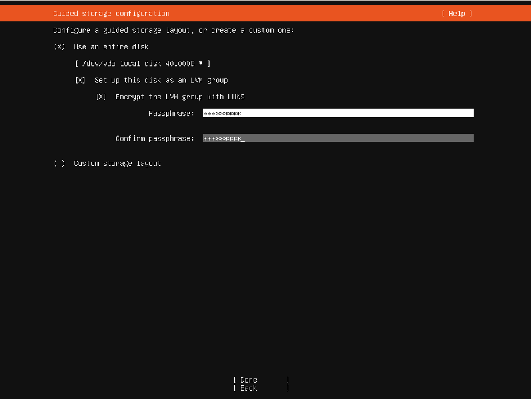
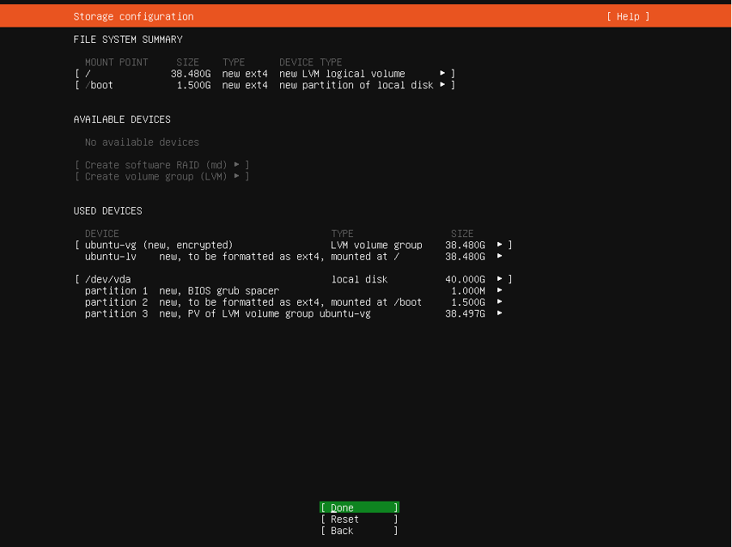
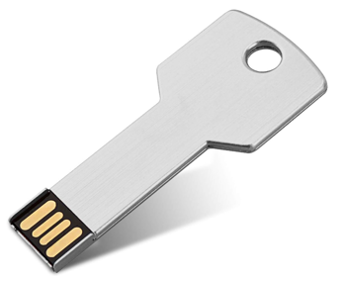

# Procedimento para Cifra do disco de Servidores Ubuntu LTS nas Unidades Sanitárias
(Disk encryption and decryption using USB drive for Health Facilities - Procedure in Portuguese)

## Introdução

Os servidores nas Unidades Sanitárias que têm o Sistema Operativo Ubuntu LTS são normalmente os sistemas que albergam as aplicações e bases de dados mais importantes - dados de
pacientes. Assim é muito importante que estejam instalados de forma a garantirem a melhor segurança e proteção de dados e isso implica que o disco esteja cifrado de forma a que os dados não sejam acedidos caso o servidor seja extraviado.

O objectivo deste procedimento é garantir que o disco dos servidores que armazenam os dados dos pacientes estejam cifrados e configurados de forma a facilitar a sua utilização pelos
intervenientes autorizados para tal, mas torne impossível a leitura dos dados para quem não está autorizado para tal, mantendo uma utilização facilitada do servidor em zonas remotas.

As palavras cifra e encriptação são sinónimas, mas neste documento iremos usar o termo cifra para designar o processo de máscara de dados em disco usando uma chave.

Qualquer esclarecimento adicional, poderá ser respondido pelo Responsável de Segurança do HIS.

Excepções a este procedimento terão de ser exclusivamente autorizadas pelo CDC.

## 1. Configuração de cifra nos Servidores Ubuntu LTS

Para se configurar a cifra nos servidores, estes têm de ser reinstalados o que significa perder todas as aplicações e dados. Assim, antes de iniciar o processo de cifra do disco, tem de se:

1. Sincronizar o servidor com a Base de Dados provincial
2. Fazer backup dos dados de todas as aplicações do servidor
3. Testar todos os backups efectuados, fazendo restore e verificar os dados extraídos.
4. Reinstalar o servidor de acordo com os procedimentos indicados a seguir (com cifra habilitada no disco)
5. Reinstalar as aplicações que existiam no servidor
6. Repor os dados no servidor
7. Testar as aplicações e os dados das mesmas

Executar estes passos demora tempo, tempo esse em que o servidor estará indisponível. É extremamente importante coordenar previamente com as várias equipas que interagem com o servidor (digitação, muzima, idmed, etc), avisando as mesmas do tempo de paragem estimado.

### 1.1. Distribuição Linux

A distribuição em uso para os servidores é Ubuntu Linux LTS. A versão exacta depende do parceiro, do tipo de servidor e aplicação a correr no servidor. É recomendável o uso da versão UBUNTU 22.04 LTS, visto que as versões anteriores deixaram de ter actualizações para novas versões de pacotes, estando restringidas a actualizações de segurança (https://ubuntu.com/about/release-cycle).

Os repositórios que devem ser utilizados nos servidores são o *main*, *restricted* e *universe*. A razão para restringir o uso do repositório *multiverse* (ver https://help.ubuntu.com/community/Repositories) é que contém software que não é gratuito, não garantindo por isso o cumprimento com as regras do MISAU (ministério da saúde).

Os servidores deverão ter os pacotes actualizados através da ferramenta ```apt update``` e ```apt upgrade```.

### 1.2. Configuração da BIOS

A BIOS deve ser protegida com uma palavra-passe (respeitando as políticas de palavra-passe existentes), para a password de administração da BIOS.
O boot deve ser configurado para fazer apenas boot do disco rígido e retirar a possibilidade de fazer boot de dispositivos móveis.
É necessário garantir que todas as passwords habilitadas por defeito (SNMP, Acesso iLO, iDRAC, RSA2) sejam alteradas e deverão ser eliminados todas as contas e serviços que não sejam necessários.

### 1.3. Configuração da Cifra do Disco

Para evitar perda de dados em caso de avaria do disco, é aconselhável que os servidores tenham no mínimo dois discos com RAID 1 configurado ou se o servidor tiver 3 ou mais discos deverá ter RAID 5 configurado, à excepção de servidores virtuais.

Deve-se preferir o RAID por *hardware*, por questões de performance, mas se o servidor não tiver uma placa de RAID, pode-se configurar o RAID por software no sistema operativo. Para mais informações sobre criação e gestão de Raids em software podem aceder à seguinte página: https://help.ubuntu.com/community/Installation/SoftwareRAID.

As partições devem ser baseadas em LVM (Logical Volume Manager) para permitir um posterior incremento ou decremento de espaço. Para mais informações sobre criação e gestão de Volume Groups podem aceder à seguinte página: https://ubuntu.com/server/docs/how-to-manage-logical-volumes.

Depois de escolher o disco a utilizar para a instalação, na altura de criação de um novo Volume Group (vg) deve escolher a cifra (escolhendo a opção “Encrypt the LVM group with LUKS”), de acordo com a imagem seguinte: 

Deverá escolher uma palavra-passe complexa (respeitando as políticas de palavra-passe existentes). É importante não esquecer a palavra-passe, no entanto, no dia a dia, será usada uma chave USB para desbloquear o disco. Esta palavra-passe poderá ser usada no caso em que as chaves USB estejam indisponíveis.

Após a criação dos Volume Groups, deverá verificar se o layout escolhido corresponde ao pretendido, nomeadamente no que concerne ao espaço de disco a utilizar.



Podem ser criados mais *Volume Groups* ou *Raids*, dependendo da configuração de discos do servidor. <ins>O que é importante de se garantir é que as partições que contém dados de pacientes estão cifradas (mesmo as partições que tenham backups que contenham informação de pacientes)</ins>.

Quando os discos são superiores a 100GB, a configuração de discos coloca o *Logical Volume principal* (ubuntu-lv) com 100GB e o restante espaço de disco fica disponível para ser adicionado posteriormente. Para se alocar todo o espaço do disco ao Logical Volume, deve-se navegar até ao ubuntu-lv, carregar em ENTER e editar o volume para se poder alocar todo o espaço de disco.

**Neste manual, para facilitar a instalação do sistema operativo, optou-se por cifrar todo o disco e colocar apenas uma partição que ocupa todo o disco.**

## 2. Desbloqueio Automático do Disco

Com o disco cifrado, o servidor pede a palavra-passe do disco em cada arranque. Para não ser preciso teclado e monitor, usa-se uma **chave USB de arranque**: com a chave ligada, o disco desbloqueia sozinho.

**Regras de utilização da chave USB:**

* Cada servidor tem **duas chaves USB**: uma com o gestor de dados (ou quem o substitua) e outra com o gestor distrital.
* Todos os dias: ligar a chave USB → ligar o servidor → depois do arranque, **retirar a chave** e guardá-la num local seguro, fechado e **longe do servidor** (caixa-forte, se existir).
* <ins>**Nunca deixar a chave USB ligada ao servidor.**</ins>
* Sem chave USB, o servidor pode ser desbloqueado com a palavra-passe do disco (definida na instalação, ver 1.3).
* **Chave USB perdida: avisar imediatamente o departamento de IT**, para que a chave seja substituída.



### 2.1. Configuração de Chaves USB para desbloquear o disco

Há dois intervenientes:

| Quem | Onde | O que faz |
|---|---|---|
| **Departamento de IT** | Servidor de chaves (central) | Cria as chaves com o *script* ```create_key.sh``` e prepara a **pen de transporte**. |
| **Técnico de campo** | Servidor da unidade sanitária | Liga a pen de transporte e executa o *script* ```setup.sh```. No fim, essa pen passa a ser a **chave USB de arranque**. |

O servidor de chaves guarda as chaves de todas as unidades sanitárias em ```keys/<ID>-<NOME>``` (ex: ```keys/1100-CS_CERAMICA```). <ins>Deve ter acesso restrito e backup.</ins>

### 2.2. Preparação do servidor de chaves (uma única vez)

Copiar ```create_key.sh``` e ```setup.sh``` para a mesma directoria no servidor de chaves (Linux) e executar:

```
sudo apt-get install uuid dosfstools
chmod +x create_key.sh setup.sh
```

### 2.3. Nova unidade sanitária

Usar uma pen USB pequena (32 MB ou mais chega) e com um formato fácil de identificar (por exemplo, em forma de chave). <ins>A pen será apagada.</ins>

#### Passo 1 - Departamento de IT: criar a chave e a pen de transporte

```
sudo ./create_key.sh --genkey
```

1. ```ID da unidade sanitaria:``` → ID sem espaços (ex: ```1100```).
2. ```Nome da unidade sanitaria:``` → nome (ex: ```cs ceramica```; fica ```CS_CERAMICA```).
3. ```Preparar agora a pen de transporte?``` → ```s```
4. ```Cifrar a pen de transporte?``` → ```s``` se a pen viajar com alguém que não é de confiança (ver 2.6).
5. Escolher o número da pen USB na lista. Se a pen não estiver ligada, o *script* pede para a inserir e carregar em ENTER (tenta uma vez; se continuar sem pen, termina).
6. Se a pen for cifrada: **anotar a palavra-passe de transporte** mostrada no fim.

#### Passo 2 - Departamento de IT: enviar a pen

Enviar a pen de transporte ao técnico de campo. Se for cifrada, enviar a palavra-passe **por outro canal** (telefone/SMS), nunca junto com a pen.

#### Passo 3 - Técnico de campo: configurar o servidor

Antes de começar, confirmar que:
* O servidor foi instalado com o disco cifrado (secção 1).
* Sabe a **palavra-passe do disco**.
* Tem a **palavra-passe de transporte**, se a pen for cifrada.
* Tem uma **segunda pen USB** (vazia ou sem nada importante) para a segunda chave USB. <ins>Será apagada.</ins>

Passos:

1. Ligar a pen de transporte ao servidor.
2. Abrir um terminal e executar **um** dos seguintes comandos:
   * **Com ambiente gráfico** (a pen abre sozinha no ecrã):
     ```
     sudo bash /media/$USER/LUKS_SETUP/setup.sh
     ```
   * **Sem ambiente gráfico** (só texto):
     ```
     sudo mount /dev/disk/by-label/LUKS_SETUP /mnt
     sudo bash /mnt/setup.sh
     ```
3. Se aparecer ```Palavra-passe de transporte:``` → escrever a palavra-passe de transporte e carregar em ENTER. <ins>O que se escreve não aparece no ecrã</ins>; os hífenes são opcionais.
4. Confirmar que a unidade sanitária mostrada está correcta, escrever ```s``` e carregar em ENTER.
5. Quando aparecer ```Enter any existing passphrase:``` → escrever a **palavra-passe do disco** e carregar em ENTER. É pedida **duas vezes** e cada passo pode demorar alguns segundos.
6. Aparece ```Chave USB de arranque n.o 1 criada.```: a pen de transporte passou a ser a **primeira chave USB de arranque**.
7. Quando aparecer ```Criar outra chave USB de arranque?``` → ```s``` para criar já a segunda chave (gestor distrital):
   1. Retirar a chave USB que está ligada (**guardá-la à parte**, já está pronta).
   2. Ligar a segunda pen e carregar em ENTER.
   3. Confirmar a pen mostrada com ```s```. Aparece ```Chave USB de arranque n.o 2 criada.```
   4. A pergunta repete-se: responder ```n``` quando já não forem precisas mais chaves.
8. Esperar pela mensagem ```Concluido: ... chave(s) USB de arranque criada(s).```
9. Com uma das chaves ligada, reiniciar o servidor (```sudo reboot```). O disco deve desbloquear sozinho (pode demorar até 20 segundos). Recomenda-se repetir o teste com a outra chave.
10. Retirar a chave USB. Entregar uma chave ao gestor de dados e a outra ao gestor distrital, que as guardam em local seguro.

Se algo correr mal, ver 2.4. Na maioria dos erros a pen **não** é apagada e basta repetir o passo 3.

#### Passo 4 - Departamento de IT: segunda chave USB (só se não foi criada no passo 3)

Se a segunda chave USB não foi criada no servidor da unidade sanitária (passo 3.7), criá-la no servidor de chaves e enviá-la:

```
sudo ./create_key.sh --spare
```

### 2.4. Problemas frequentes (técnico de campo)

| Mensagem / situação | O que fazer |
|---|---|
| ```special device /dev/disk/by-label/LUKS_SETUP does not exist``` ou a pen não aparece | Confirmar que a pen está bem ligada (ou mudar de porta USB) e repetir. |
| ```Este script tem de ser executado a partir da pen USB de transporte.``` | Executar o ```setup.sh``` que está na pen, com um dos comandos do passo 3.2. |
| ```Nao foi possivel desmontar a pen``` | Fechar as janelas e terminais abertos na pen e executar o comando indicado na mensagem. |
| ```Palavra-passe errada.``` | Confirmar a palavra-passe de transporte com o departamento de IT. Após 3 tentativas o *script* pára; repetir o passo 3. |
| ```Nenhuma particao LUKS encontrada neste servidor.``` | O disco não está cifrado. O servidor tem de ser instalado conforme a secção 1. |
| ```No key available with this passphrase.``` | Palavra-passe do disco errada. Repetir o passo 3. |
| Mensagem com ```A pen NAO foi apagada``` | Repetir o passo 3. Se voltar a falhar, contactar o departamento de IT. |
| ```falhou a preparacao desta pen``` | Responder ```s``` a ```Criar outra chave USB de arranque?``` e tentar com outra pen. |
| ```Nenhuma pen nova encontrada.``` | Ligar a nova pen (ou mudar de porta USB) e responder ```s``` novamente. A pen tem de ser diferente das que já foram preparadas. |
| ```nenhuma chave USB foi criada``` | Contactar o departamento de IT para criar uma chave USB (```--spare```). Até lá, no arranque, usar a palavra-passe do disco. |
| No arranque aparece ```Insira chave USB e pressione ENTER:``` | A chave USB não foi encontrada: ligar a chave e carregar em ENTER, ou escrever a palavra-passe do disco. |

### 2.5. Outras operações (departamento de IT)

Todas no servidor de chaves. Excepto a ```--genkey```, as operações pedem apenas o **ID** da unidade sanitária. (Para unidades criadas com versões anteriores dos *scripts*, com a directoria ```keys/<nome>```, o ID é o nome da directoria.)

| Situação | Comando |
|---|---|
| Procurar uma unidade sanitária | ```./create_key.sh --list [texto]``` (ex: ```--list 1100```, ```--list nama```; sem *sudo*) |
| Pen de transporte **avariada** antes da instalação | ```sudo ./create_key.sh --transport [--enc]``` e repetir os passos 2 e 3 |
| Chave USB **avariada** | ```sudo ./create_key.sh --spare``` |
| Chave USB ou pen de transporte **perdida** | ```sudo ./create_key.sh --rotate [--enc]``` (ver abaixo) |
| Técnico precisa da palavra-passe de transporte | ```cat keys/<ID>-<NOME>/transport-password.txt``` |
| Servidor sem nenhuma chave USB | No arranque, escrever a palavra-passe do disco ou o código de recuperação (```keys/<ID>-<NOME>/luks-recover-key.txt```) |

**Substituição da chave (```--rotate```).** Todas as chaves USB de uma unidade sanitária têm a mesma chave; por isso, <ins>se uma chave USB ou pen de transporte se perder, a chave tem de ser substituída</ins>:

1. ```sudo ./create_key.sh --rotate [--enc]```: a chave actual é guardada em ```keys/<ID>-<NOME>/old/``` e é preparada uma pen de transporte com a chave nova e todas as chaves antigas (para serem removidas).
2. O técnico de campo executa o **passo 3**, igual à instalação, mas **não é pedida a palavra-passe do disco**. O *setup.sh* só remove as chaves antigas depois de confirmar que a nova funciona.
3. Se a segunda chave USB não foi criada no passo 3, criá-la com ```--spare```. **Recolher as chaves USB antigas**, que deixam de funcionar.

Notas: a palavra-passe do disco não é alterada. Chaves USB criadas com ```--spare``` depois de um ```--rotate``` só funcionam depois de o passo 3 ter sido executado no servidor.

### 2.6. Segurança

* A pen de transporte contém a chave do servidor: deve ser tratada como uma chave USB. <ins>Se se perder, usar ```--rotate```</ins>.
* **Pen cifrada (```--enc```)**: usar quando a pen viaja com alguém que não é de confiança. As chaves vão cifradas (AES-256) no ficheiro *chaves.enc*, com uma palavra-passe de transporte aleatória, diferente para cada pen, registada em ```keys/<ID>-<NOME>/transport-password.txt```. A cifra serve apenas para o transporte: no servidor de chaves e na chave USB de arranque as chaves ficam sem cifra (o servidor tem de as ler no arranque, sem intervenção).
* O *setup.sh* copia a pen para RAM e decifra as chaves apenas em RAM; os ficheiros temporários são apagados no fim.
* A chave USB de arranque não aparece noutros computadores (Windows, etc.), o que dificulta o seu uso para outros fins.
* O código de recuperação (```luks-recover-key.txt```) fica apenas no servidor de chaves; é apagado da pen quando esta passa a chave USB de arranque.
